# [👋]{.wave} Welcome

```{=html}
<style>
  .wave {
  animation-name: wave-animation;
  animation-duration: 2.5s;
  animation-iteration-count: infinite;
  transform-origin: 70% 70%;
  display: inline-block;
}

@keyframes wave-animation {
    0% { transform: rotate( 0.0deg) }
   10% { transform: rotate(14.0deg) }
   20% { transform: rotate(-8.0deg) }
   30% { transform: rotate(14.0deg) }
   40% { transform: rotate(-4.0deg) }
   50% { transform: rotate(10.0deg) }
   60% { transform: rotate( 0.0deg) }
  100% { transform: rotate( 0.0deg) }
}
</style>
```

<!-- TODO: add QR code linking to the workshop handout / resources -->

::: notes
Moldova and Romania are on UTC+2 since 25 October; Türkiye stays on UTC+3. Say the break and end times in both.
:::


## Who am I?

<br>

I'm **Nicu Calcea**.

I'm a **data investigative journalist**, specialising in environmental data.

I studied and taught at **City, University of London**, and have done data journalism at ***Global Witness***, ***BBC News*** and the ***New Statesman***.


## My work

- [UK PR firms increased fossil fuels lobbying since Paris Agreement](https://globalwitness.org/en/campaigns/fossil-fuels/uk-pr-firms-increased-fossil-fuels-lobbying-since-paris-agreement/)
- [Eight out of ten firms pay men more than women](https://www.bbc.co.uk/news/business-65179430)
- [Exclusive: Tory MPs would be over £1m worse off in six months with Boris Johnson's second job ban](https://www.newstatesman.com/politics/uk-politics/2021/11/exclusive-tory-mps-would-be-over-1m-worse-off-in-six-months-with-boris-johnsons-second-job-ban) ([archive](https://archive.is/t7Boc))


## Today's plan {.smaller}

| | |
|:--|:--|
| 00:00 | Introductions |
| 00:10 | Core concepts: open data and how to use it |
| 00:30 | Where to find data, and tools to analyse and visualise it |
| 01:00 | **Exercise 1:** check your claim against the data |
| *01:30* | *Break* |
| 01:40 | Requesting information |
| 01:50 | **Exercise 2:** from evidence to campaign sketch |
| 02:20 | Conclusions and next steps |
| 02:30 | Close |


## By the end of today, each group should have {.smaller}

- Its key claims **checked against the best available data**, with the gaps named.
- A **toolkit** of free data sources and tools for climate and the environment.
- A **draft information request** for the most important missing piece.
- A **campaign sketch** that can grow into the policy paper.


## Why are we here?

How cities cope with climate change is decided at the international, national and local level.

Those decisions rest on **budgets, contracts, measurements and plans**. Much of this is public, or should be.

::: {.fragment}
A campaign that **presents clear evidence**, **names the authority responsible** and **asks for a specific outcome** is much more likely to be succesful.
:::

## Good timing {.smaller}

::: {.incremental}
- **COP31**, the UN climate conference, opens in **Antalya** on 9 November, two days from now. Türkiye hosts, Australia leads the negotiations.
- Türkiye's Ministry of Education is choosing **81 young delegates, one per province**, each preparing a climate report card for their province.
- The Council of Europe asks governments to give young people **"full access to climate-related information and data"**.
:::

::: footer
Sources: [UNFCCC / Australian Government](https://unfccc-cop.dcceew.gov.au/cop31), [MEB](https://www.meb.gov.tr/cop31-icin-81-ilden-81-genc-delege-belirlenecek/haber/42090/tr), [CM/Rec(2024)6](https://rm.coe.int/cm-rec-2024-6-young-people-and-climate-action/1680b21a0e)
:::


# Core concepts

## The process

::: columns
::: {.column width="33.33%"}
:::  {.fragment}
##### Question
Start with a question you want to answer, or a claim you want to test.
:::
:::

::: {.column width="33.33%"}
:::  {.fragment}
##### Find sources
Data can come from official sources, civil society, other third parties, or be collected by you.
:::
:::

::: {.column width="33.33%"}
:::  {.fragment}
##### Clean and structure
You will usually have to filter, sort and fix errors or missing information.
:::
:::
:::

## The process

::: columns
::: {.column width="33.33%"}
##### Analyse
How do you find the answer to your question in the data?
:::

::: {.column width="33.33%"}
:::  {.fragment}
##### Verify
Data doesn't lie, but those who publish it might. Do your conclusions make sense? Can you check them against another source?
:::
:::

::: {.column width="33.33%"}
:::  {.fragment}
##### Present
Share your findings in the way that best reaches your audience: a mayor, a council, the Council of Europe. Sometimes, but not always, that means a chart.
:::
:::
:::

::: notes
Analyse data: be platform agnostic. Some tools die because APIs change, others are abandoned by their developers, some are replaced by better alternatives.
:::


## What is open data? {.smaller}

> Open data and content can be freely used, modified, and shared by anyone for any purpose. --- **The Open Definition**

In practice, that means:

- **Free access**: no registration, available to anyone, at any time.
- **Open, structured format**: readable by people *and* software (CSV, XLSX, JSON). ~~PDF~~, ~~DOCX~~, ~~scanned images~~.
- **Open licence**: you can reuse it, as long as you credit the source.

::: footer
Source: [Open Knowledge Foundation](https://opendefinition.org/)
:::

::: notes
Most of what participants will find in the three countries is "public" but not "open": PDFs, scans, tables on web pages. Still usable, just more work.
:::


## What can data tell your group? {.smaller}

| Group | A question data can answer |
|:--|:--|
| Law and policies | Which youth bodies exist, from Strasbourg down to our cities? Which have a climate mandate? |
| Youth participation | What did our survey respondents say, and how does it compare with Europe? |
| Natural garden | How much water would a lawn need in your city last summer, compared with low-water plants? |
| Eco-Health Pass | How many days above 30°C does your city get, and where are the water points? |

::: notes
Most of what participants will find in the three countries is "public" but not "open": PDFs, scans, tables on web pages. Still usable, just more work.
:::

## Data is not neutral

- Published data reflects the choices and limits of those who collect it.
- Averages hide differences: a city average can hide a very hot neighbourhood.
- A missing dataset is also a finding. It tells the authority what to start measuring.
- When data doesn't exist, you can [ask for it](#requesting-information) or [create it](https://maps.sensor.community/).


# Examples

## Green to Grey

<iframe class="stretch" data-src="https://greentogrey.eu/"></iframe>

::: footer
Source: [Green to Grey](https://greentogrey.eu/), [Arena for Journalism in Europe](https://journalismarena.eu/tag/g2g)
:::

::: notes
41 journalists and scientists from 11 countries, coordinated by Arena for Journalism in Europe with NINA. Found Europe lost about 600 football pitches of nature and cropland a day (2018–2023), and that official datasets undercount land take because they miss small developments. Lesson: official data has gaps, and you can show them.
:::

## Forever Pollution (Europe) {.smaller}

In 2023, *Le Monde* and 17 media partners mapped **PFAS "forever chemicals"** across Europe.

- They located **nearly 23,000 contaminated sites**, and another 21,500 likely ones.
- Most measurements already existed, scattered across agencies and countries. The team gathered around **100 datasets** and filed **freedom of information requests** for the rest.
- In 2025, a follow-up exposed the industry lobbying against an EU ban on PFAS.

The data was public. Nobody had put it in one place.

::: footer
Source: [The Forever Pollution Project](https://foreverpollution.eu/), [Le Monde](https://pfasproject.com/2023/02/23/the-forever-pollution-project/)
:::

## Kara Rapor (Türkiye) {.smaller}

Every year since 2016, the [Right to Clean Air Platform](https://temizhavahakki.org/), a coalition of health professionals' and environmental groups, has analysed the Ministry's own monitoring data.

- **Kara Rapor 2025:** no province had good air quality in 2024. Bringing PM2.5 down to WHO levels would save at least **60,000 lives a year**.
- It reports the **gaps** too: only some of the 380 stations produce enough data, and İzmir's again didn't.
- A petition called on the Ministry to set a **legal limit for PM2.5**.

Official data, analysed every year, keeps the issue on the agenda.

::: footer
Source: [Temiz Hava Hakkı Platformu, Kara Rapor 2025](https://temizhavahakki.org/kara-rapor-2025/)
:::

::: notes
The 2025 edition also put a price on PM2.5 pollution for the first time: about $138 billion a year, roughly 10% of Türkiye's 2024 GDP.
:::

## Forests: Moldova and Romania {.smaller}

::: columns
::: {.column width="50%"}
##### Moldova: *Forest Thieves*

In 2021, [Ziarul de Gardă](https://www.zdg.md/en/top-five-zdg-articles-from-2021-that-generated-files/) used recordings, testimony and documents to show how forests were illegally cut and sold, with help from inside the forestry system.

In 2023, prosecutors opened a case over **more than 1,400 illegally felled trees**, targeting [two foresters named in the investigation](https://www.zdg.md/en/the-head-of-a-forestry-farm-in-hincesti-and-his-son-about-whom-zdg-wrote-in-the-investigation-forest-thieves-ii-targeted-in-the-case-of-illegal-felling-of-1400-trees/).
:::

::: {.column width="50%"}
##### Romania: EU complaint

Agent Green, EuroNatur and ClientEarth documented logging in protected **Natura 2000** forests, and complained to the European Commission in 2019 and 2020.

The Commission [opened infringement proceedings](https://www.clientearth.org/latest/press-office/press/eu-announces-legal-action-against-romania-for-illegal-logging-of-europe-s-last-natural-forests) in 2020. The NGOs kept monitoring, combining field visits, satellite images and the state's own [logging permits](https://www.clientearth.org/latest/press-office/illegal-logging-of-romania-s-natural-forests-increases-despite-court-threat-new-report).
:::
:::

::: notes
Moldova: the state forestry agency, Moldsilva, initially said it had found no irregularities; an MP filed a criminal complaint based on the investigation. A forester named in it tried to hit the ZdG journalist with his car. Safety matters when you investigate locally.

Romania: the Commission sent a reasoned opinion, its last warning before court, in July 2020. As of 2023, Romania had not been referred to the EU Court of Justice, and NGOs and the European Parliament were still pressing. Not a clean win, which is the honest picture.
:::

## CurieuzeNeuzen (Belgium) {.smaller}

In May 2018, **20,000 people** in Flanders (Belgium) hung simple air samplers on windows facing the street, for a month.

- The University of Antwerp, the regional environment agency and the newspaper *De Standaard* ran it together.
- 84% of municipalities had at least one **hotspot** well above their own average. Pollution varied between streets, sometimes within the same street.
- *De Standaard* compared cities: Antwerp came out dark red, while Ghent, which had just cut through traffic in its centre, did better.

::: footer
Source: [VMM](https://vmm.vlaanderen.be/pers/2018-09-29-persbericht-resultaten-curieuzeneuzen-2018.pdf/@@download/file), [EEB](https://meta.eeb.org/2018/10/04/five-things-we-learnt-when-20000-belgians-became-air-pollution-scientists/)
:::

::: notes
Samplers measured NO₂, mostly from traffic. 96% of the samples returned valid results. Sensor.Community is the low-cost equivalent participants can join today.
:::

## When the city says no: Cluj's air sensors

In 2021, NGOs in Cluj-Napoca crowdfunded **22 air-quality sensors**.

City Hall refused to host them on its poles, saying it had its own air quality plan.

So they asked residents and businesses to **"adopt" a sensor** on their balconies. The data is public.

::: footer
Source: [Actual de Cluj](https://actualdecluj.ro/refuzati-de-primarie-civicii-din-cluj-cheama-comunitatea-sa-adopte-cei-22-de-senzorii-de-monitorizare-a-aerului-cumparati-in-urma-unei-campanii-de-strangere-de-fonduri/)
:::

::: notes
Citizen sensor networks exist in all three countries (Sensor.Community has sensors across Moldova, Romania and Türkiye). Official refusal is not the end of the story.
:::

## Youth and digital participation in the region {.smaller}

- [**Sofia Decides**](https://www.interregeurope.eu/good-practices/sofia-decides-civic-participation-platform-for-transparent-local-decision-making) (Bulgaria): an open-source platform (Decidim). **11,589 people** voted in its first citizens' budget (7,105 online), which allocated BGN 5.3 million and included a greening category. Voting is 18+.
- [**Com'ON Cluj-Napoca**](https://comoncluj.ro/) (Romania): a youth participatory budget run with City Hall since 2015. Its Green Mission 2030 strand links youth ideas to the city's climate neutrality goal.
- [**Chișinău Civic Budget**](https://logos-pres.md/noutati/locuitorii-capitalei-au-primit-3-milioane-de-lei-pentru-proiectele-lor/) (Moldova): 3 million lei a year for residents' projects. Energy efficiency and urban mobility are eligible.
- [**Young Voices, Participatory Cities**](https://www.stgm.org.tr/en/young-voices-shaping-their-cities-tekirdag-applications-open-young-voices-participatory-cities) (Türkiye, 2025): 20 young people mapped their district's needs and presented proposals to local officials.

::: notes
Honest framing: I could not find a documented case in our three countries where a city changed a climate decision because of evidence young people produced. That's the gap this project can fill.
:::


# Where to find data

## Local and national data {.smaller}

::: columns
::: {.column width="33.33%"}
##### Moldova

- [StatBank](https://statbank.statistica.md/PxWeb/pxweb/ro/): national statistics, the most reliable starting point
- [date.gov.md](https://date.gov.md/): government data portal
- [Environment Agency bulletins](https://am.gov.md/ro/rapoarte/buletine-lunare-privind-calitatea-mediului): monthly air, water and soil data (PDF)
:::

::: {.column width="33.33%"}
##### Romania

- [TEMPO Online](http://statistici.insse.ro:8077/tempo-online/): statistics down to locality level
- [calitateaer.ro](https://www.calitateaer.ro/): national air quality network, 100+ stations, hourly data
- [data.gov.ro](https://data.gov.ro/): open data
:::

::: {.column width="33.33%"}
##### Türkiye

- [TÜİK data portal](https://veriportali.tuik.gov.tr/): national statistics
- [MGM climate statistics](https://www.mgm.gov.tr/veridegerlendirme/il-ve-ilceler-istatistik.aspx): long-term temperature and rainfall for every province
- [National air quality network](https://havaizleme.gov.tr/): official stations, hourly data
:::
:::

::: notes
dataset.gov.md did not load from outside Moldova in my checks; StatBank is the safe fallback. havaizleme.gov.tr may not load from outside Türkiye; use AQICN or OpenAQ instead.
:::


## European and global data {.smaller}

- [Copernicus Interactive Climate Atlas](https://atlas.climate.copernicus.eu/): past and projected climate for any region
- [European Climate Data Explorer](https://climate-adapt.eea.europa.eu/en/eu-adaptation/assessing-climate-risks/european-climate-data-explorer): heat, drought and flood indicators
- [EEA Air Quality Index](https://airindex.eea.europa.eu/AQI/index.html): official stations across Europe
- [AQICN](https://aqicn.org/map/europe/) and [OpenAQ](https://explore.openaq.org/): air quality maps covering all three countries
- [Open-Meteo](https://open-meteo.com/en/docs/historical-weather-api): historical weather for any location, free for non-commercial use, no account
- [overpass turbo](https://overpass-turbo.eu/): what OpenStreetMap knows about parks, trees, water points or bus stops
- [Sensor.Community](https://maps.sensor.community/): citizen-run air quality and temperature sensors

## Plans and promises: national {.smaller}

Every promise is a benchmark you can measure your authorities against.

| Country | Promise | Where it's written |
|:--|:--|:--|
| Moldova | Cut emissions **75% below 1990 levels by 2035**; climate neutrality by 2050 | [NDC 3.0](https://unfccc.int/sites/default/files/2025-05/MD_NDC_3.pdf) (May 2025) |
| Romania | EU targets: cut net emissions **at least 55% below 1990 by 2030**; climate neutrality by 2050 | [European Climate Law](https://climate.ec.europa.eu/eu-action/european-climate-law_en) |
| Türkiye | **Net zero by 2053**, now in law. The 2035 target still lets emissions grow until they peak, by 2038 at the latest | [Climate Law 7552](https://www.mevzuat.gov.tr/mevzuatmetin/1.5.7552.pdf) (July 2025), [2035 NDC](https://climateactiontracker.org/countries/turkey/) |

::: notes
Romania's updated national energy and climate plan (2025) goes further, aiming for climate neutrality by 2045. Climate Action Tracker rates Türkiye's targets "insufficient": the 2035 NDC caps emissions at 643 MtCO₂e, above today's level.
:::

## Plans and promises: local {.smaller}

- **Türkiye:** the Climate Law requires a **local climate change action plan for every province**, prepared by the metropolitan or provincial municipality under the governor, by **31 December 2027**. Those plans are being written now.
- **Moldova and Romania:** no law requires a city to have a climate plan. Most that have one made it through the [Covenant of Mayors](https://eu-mayors.ec.europa.eu/en/signatories).

::: {.fragment}
Look up your city:

- Has it joined the Covenant of Mayors? When?
- Did it submit a plan? Do its targets go beyond **2020**?
- Has it reported any progress since?
:::

::: footer
Source: [Law 7552, Art. 7 and provisional Art. 1](https://www.mevzuat.gov.tr/mevzuatmetin/1.5.7552.pdf), [Covenant of Mayors](https://eu-mayors.ec.europa.eu/en/signatories)
:::

::: notes
Examples of what participants may find: Tekirdağ approved a plan in January 2024 (80% cut by 2050, with flood and heat risk maps); Galați's 2016 plan only had 2020 targets; Chișinău joined in 2011 but never submitted a plan. One to hold to account, one that has expired, none at all. The Turkish deadline can be extended by one year.
:::

## Following decisions {.smaller}

Draft decisions and consultations are published, if you know where to look:

- **Moldova:** [particip.gov.md](https://particip.gov.md/) (national drafts), the [State Register of Local Acts](https://actelocale.gov.md/) (council decisions), your city hall's *consultări publice* page. Chișinău's consultation on the **environmental studies** for its 2040 urban plan closed on **4 November**, after only five weeks.
- **Romania:** each city and county website's *Transparență decizională* and *Monitorul Oficial Local* sections (Law 52/2003).
- **Türkiye:** council meetings are public, and decision summaries must be announced within 7 days (Law 5393, Art. 20). Many councils publish decisions on [e-Devlet](https://www.turkiye.gov.tr/arama?aranan=meclis+karar%C4%B1).


## Common problems

- Data is often published in inaccessible (PDF, scans) or inconsistent formats.
- Many datasets are out of date or incomplete.
- City-level data is hard to find, and often doesn't exist.
- The three countries measure different things, in different ways, so compare with care.
- Some government portals don't load from abroad.


# Tools

<iframe class="stretch" data-src="https://samizdata.co/training/toolbox/"></iframe>

::: footer
Source: [SAMIZDATA](https://samizdata.co/training/toolbox/)
:::

## Potential starting points {.smaller}

| Group | Tool | What to do |
|:--|:--|:--|
| Law and policies | A shared spreadsheet | One row per youth body: level, who picks members, climate mandate, consultative or binding, **must the authority respond?** |
| Youth participation | [Datawrapper](https://www.datawrapper.de/) | Turn agree/disagree answers into a 100% stacked bar chart, with the number of respondents |
| Natural garden | [Open-Meteo](https://open-meteo.com/en/docs/historical-weather-api) | Download daily evapotranspiration (`et0_fao_evapotranspiration`) and rainfall for your city, June–August |
| Eco-Health Pass | [overpass turbo](https://overpass-turbo.eu/), [Open-Meteo](https://open-meteo.com/en/docs/historical-weather-api) | Export `amenity=drinking_water` or `highway=bus_stop` as GeoJSON; count days above 30°C per summer |

::: notes
Demo one of these live, depending on what came in from the pre-training tasks. Open-Meteo is the quickest to show.
:::


## Making your work checkable {.smaller}

::: columns
::: {.column width="50%"}
Documentation

- keep a link to the original source
- note what you did to the data
- use meaningful column names (not "value") and sheet names (not "Sheet1")
- one question = one sheet
:::

::: {.column width="50%"}
Reproducibility

- work on a copy, never on the original data
- protect the original sheet
- no names, emails or phone numbers in shared survey data
:::
:::


## {#dirty-data data-menu-title="Dirty Data" .smaller}

::: columns
::: {.column width="33.33%"}
##### Missing data
Records disappear or were never collected. It's not always obvious when this happens.
:::

::: {.column width="33.33%"}
##### Duplicate data
Records can be repeated, because of technical errors or repeated data entry.
:::

::: {.column width="33.33%"}
##### Spelling mistakes
People make mistakes. Assume any dataset typed in by hand contains typos ("Agree", "agree ", "4").
:::

::: {.column width="33.33%"}
<br>

##### Bad formatting
Some spreadsheets are designed to be read by humans, not computers, and need extra processing.
:::

::: {.column width="33.33%"}
<br>

##### Inconsistent data
A column might mix units of measurement, name categories differently, or use different methods.
:::

::: {.column width="33.33%"}
<br>

##### Changing stations
A sensor moved, was replaced, or the method changed. Check for breaks in the series.
:::
:::


# Visualising data

## Why visualise data? {background-color="#EAE8E3"}

Summarising data is not always enough to spot patterns.

Visualising it can show us things we would otherwise miss.


## {#alegeri-rusia data-menu-title="Russia elections chart"}

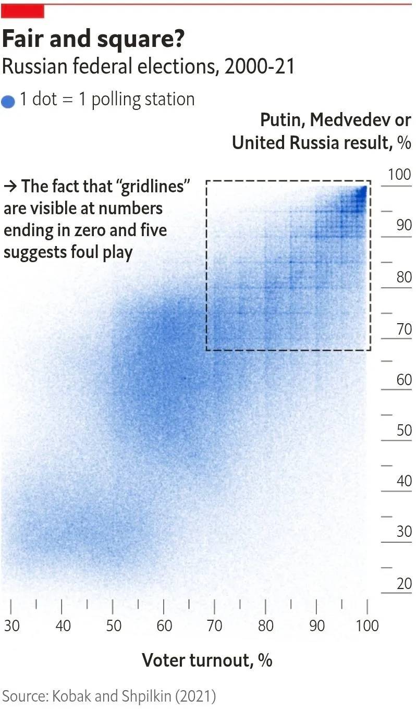


## What can we visualise? {.smaller background-color="white"}

Position 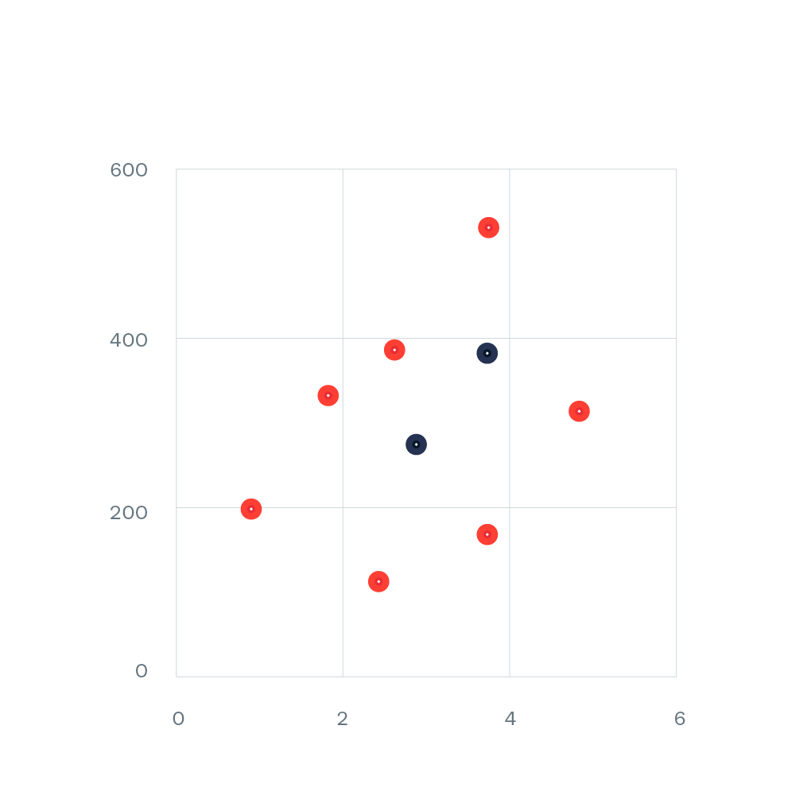{.absolute top=100 right=50 width="500" height="500"}

::: {.fragment}
Size

&nbsp;&nbsp;&nbsp;&nbsp;Width 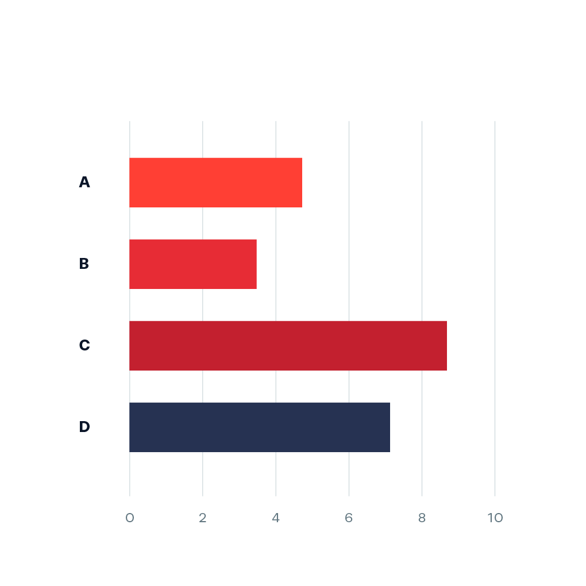{.absolute top=100 right=50 width="500" height="500"}
:::

::: {.fragment}
&nbsp;&nbsp;&nbsp;&nbsp;Height 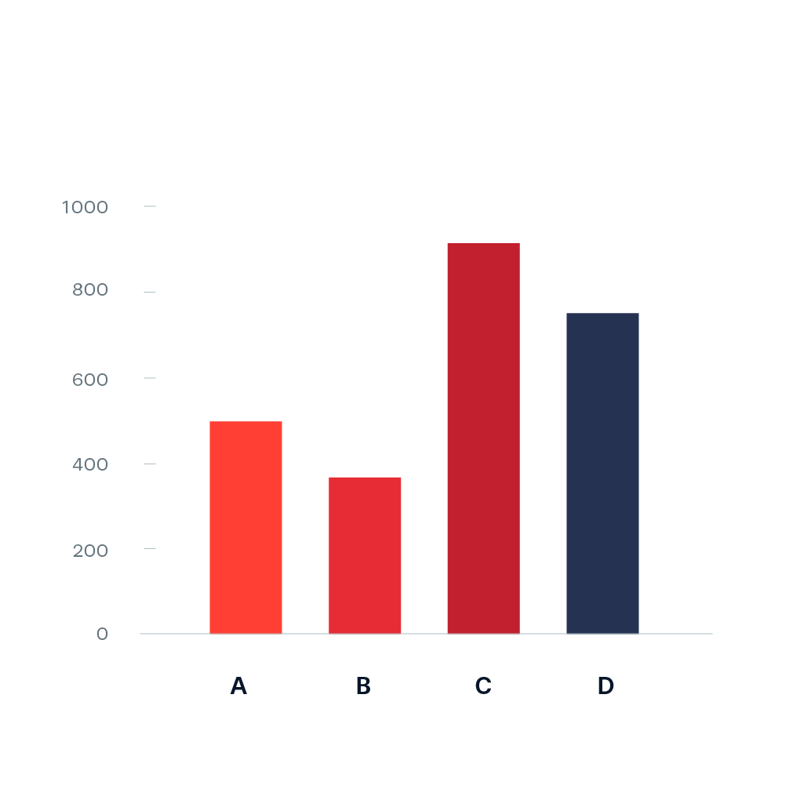{.absolute top=100 right=50 width="500" height="500"}
:::

::: {.fragment}
&nbsp;&nbsp;&nbsp;&nbsp;Area 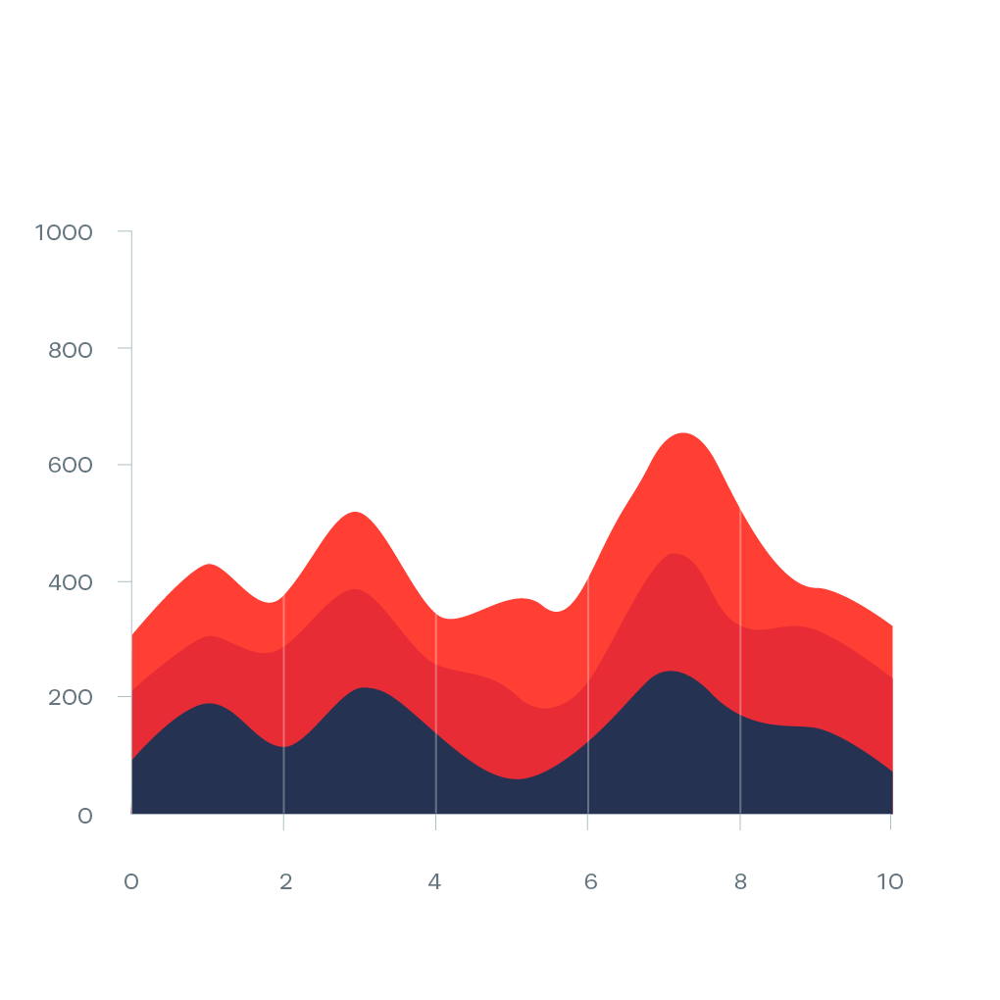{.absolute top=100 right=50 width="500" height="500"}
:::

::: {.fragment}
Colour

&nbsp;&nbsp;&nbsp;&nbsp;Fill 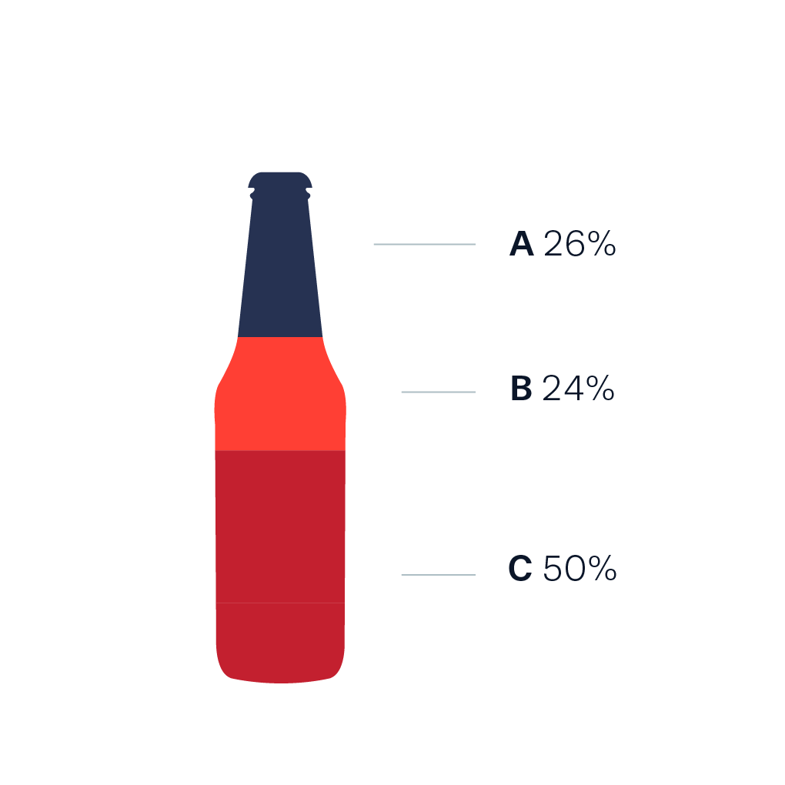{.absolute top=100 right=50 width="500" height="500"}
:::

::: {.fragment}
&nbsp;&nbsp;&nbsp;&nbsp;Hue 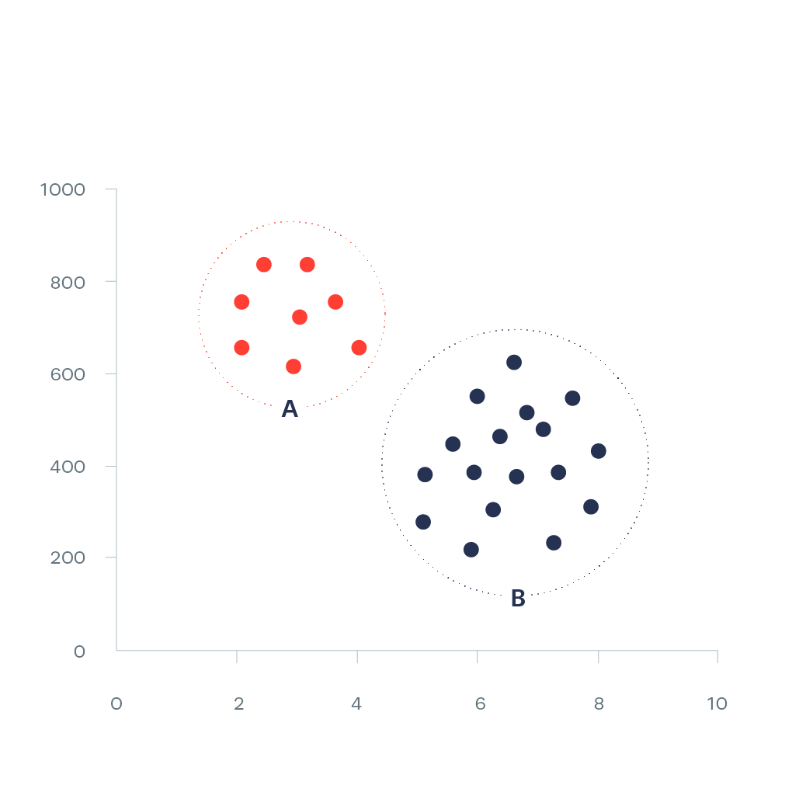{.absolute top=100 right=50 width="500" height="500"}
:::

::: {.fragment}
&nbsp;&nbsp;&nbsp;&nbsp;Transparency

&nbsp;&nbsp;&nbsp;&nbsp;Pattern

Shape {.absolute top=100 right=50 width="500" height="500"}
:::

::: {.fragment}
Location 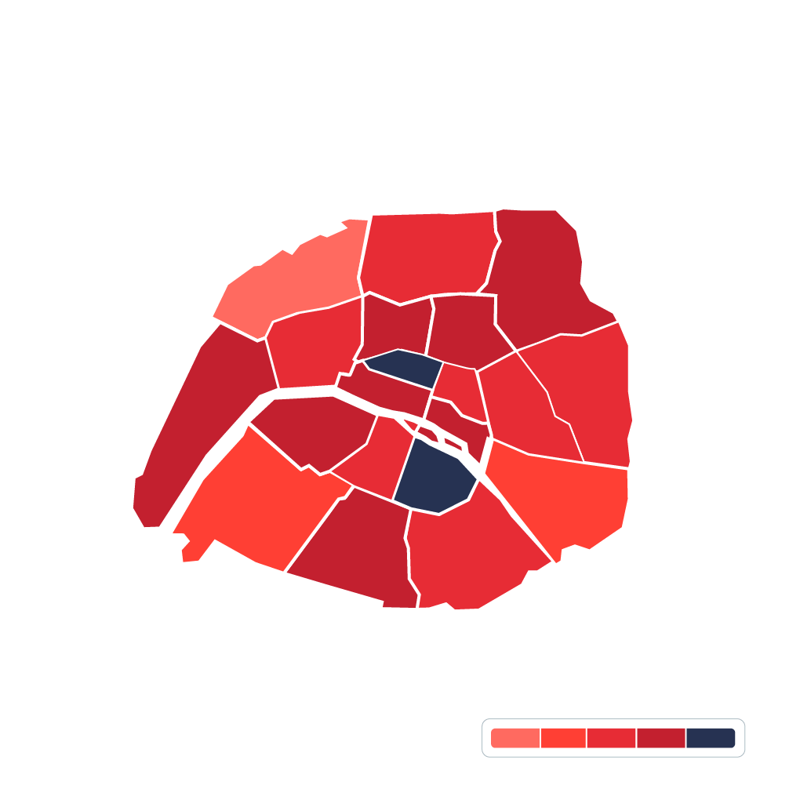{.absolute top=100 right=50 width="500" height="500"}
:::


## Which visual encodings can you spot in this chart? {background-color="#fff1e0"}

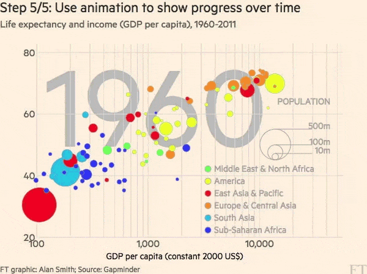{.absolute height="500"}

## The FT scatter plot {background-color="#fff1e0"}

::: {.fragment .fade-in-then-out}
Scatter plot {.absolute top=100 right=20 height="450"}
:::

::: {.fragment .fade-in-then-out}
Logarithmic scale {.absolute top=100 right=20 height="450"}
:::

::: {.fragment .fade-in-then-out}
Change the sizes {.absolute top=100 right=20 height="450"}
:::

::: {.fragment .fade-in-then-out}
Add colour {.absolute top=100 right=20 height="450"}
:::

::: {.fragment}
Animate the years {.absolute top=100 right=20 height="450"}
:::

::: notes
https://www.ft.com/content/e2eba288-ef83-11e6-930f-061b01e23655
:::


## Choosing a chart

- [FT Visual Vocabulary](https://ft-interactive.github.io/visual-vocabulary/)
- [Data Viz Project](https://datavizproject.com/)
- [Data to Viz](https://www.data-to-viz.com/)
- [Data Visualisation Catalogue](https://datavizcatalogue.com/)


## Bars/columns { background-color="white"}

::: columns
::: {.column width="60%"}

:::

::: {.column width="40%"}
Horizontal or vertical rectangles whose lengths are proportional to the values they represent.
<br><br>
Good for comparing numbers, e.g. youth councillors in each city.
:::
:::

## Lines { background-color="white"}

::: columns
::: {.column width="60%"}
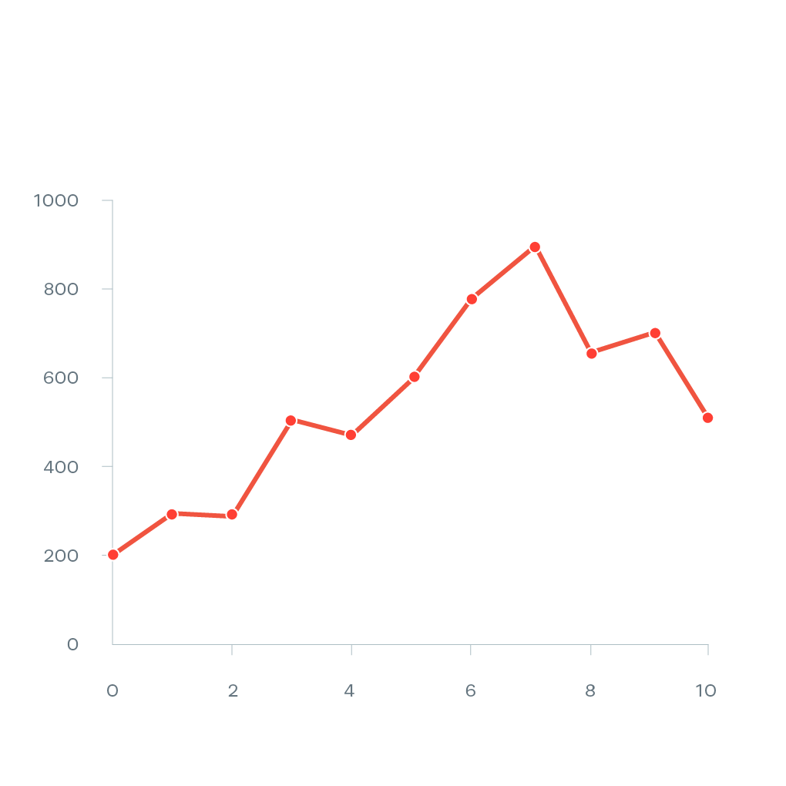
:::

::: {.column width="40%"}
Show numbers on a continuous scale. Similar to a scatter plot, but with the points connected.
<br><br>
Good for showing trends, e.g. hot days per summer over 20 years.
:::
:::

## Area charts { background-color="white"}

::: columns
::: {.column width="60%"}

:::

::: {.column width="40%"}
Like line charts, but with the area under the line filled in. Stacked, they can show how a total is made up over time.
<br><br>
Good for showing trends, e.g. emissions by sector.
:::
:::

## Scatter plots { background-color="white"}

::: columns
::: {.column width="60%"}

:::

::: {.column width="40%"}
Plot a dataset along two continuous dimensions, one on each axis (X and Y).
<br><br>
Good for showing the relationship between two variables, e.g. tree cover and summer temperature.
:::
:::

## Maps { background-color="white"}

::: columns
::: {.column width="60%"}

:::

::: {.column width="40%"}
Only work with geographic data (obviously!).
<br><br>
Even with geographic data, other chart types are often a better choice.
:::
:::

## Survey answers {background-color="white"}

<iframe class="stretch" data-src="https://www.datawrapper.de/blog/divergingbars"></iframe>

::: footer
Source: [Datawrapper](https://www.datawrapper.de/blog/divergingbars)
:::

::: notes
For the Youth participation group: agree/disagree questions work best as 100% stacked bars. Always show how many people answered, and say "our respondents", not "young people in Moldova".
:::


## Anatomy of a chart {background-color="white"}


::: footer
Source: [BBC News](https://www.bbc.com/news/business-64322574)
:::

::: notes
- Title
- Subtitle / description
- Series
- Labels
- Gridlines
- x-axis
- y-axis
- Legend/key
- Source
:::

## Choosing colours {background-color="white"}


::: notes
Sequential: Colours (of the same hue) that go from light to dark or the other way around. Usually, darker means higher value.

Diverging: Similar to sequential, but they have a light middle colour that turns darker on both ends of the scale. Useful when you have both positive and negative values.

Categorical: For values that aren't on a numeric scale or don't have an intrinsic order. Useful when none of the colours are more important than others.

For temperature: red for hot, blue for cold, and check for colour blindness.
:::

::: footer
Source: [Datawrapper](https://www.datawrapper.de/blog/which-color-scale-to-use-in-data-vis)
:::


## Datawrapper

Free charts and maps, no coding. You need a free account, and charts carry a small "Created with Datawrapper" credit.

1. Go to [datawrapper.de](https://www.datawrapper.de/) and create a chart.
2. Paste your data from a spreadsheet.
3. Pick a chart type, then add a title, a description and a **source**.
4. Publish, or download as a PNG.

::: notes
Check that everyone has an account before Exercise 1.
:::


## Bad charts: Daily Mail


::: footer
Source: [Daily Mail](https://www.dailymail.co.uk/news/article-8028565/EU-leaders-argue-early-hours-bruising-budget-talks.html)
:::

## Bad charts: The Sun
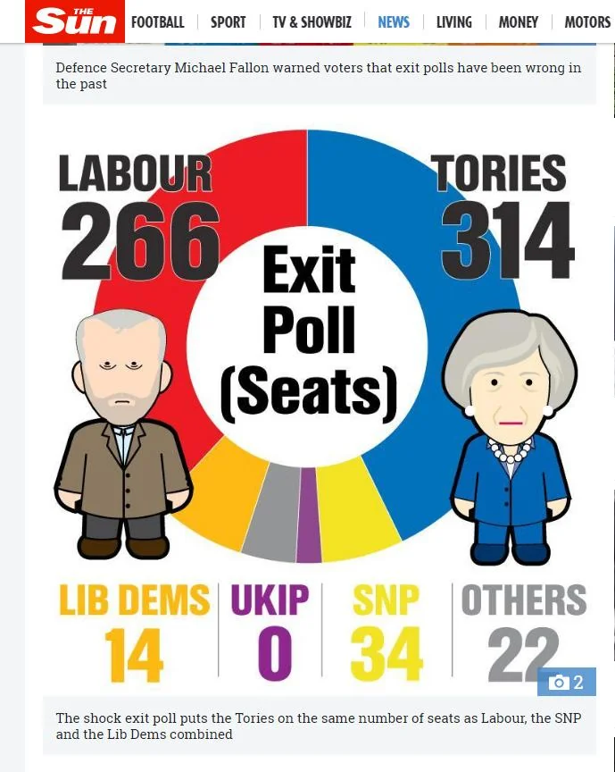

::: footer
Source: The Sun
:::

## Bad charts: Reuters
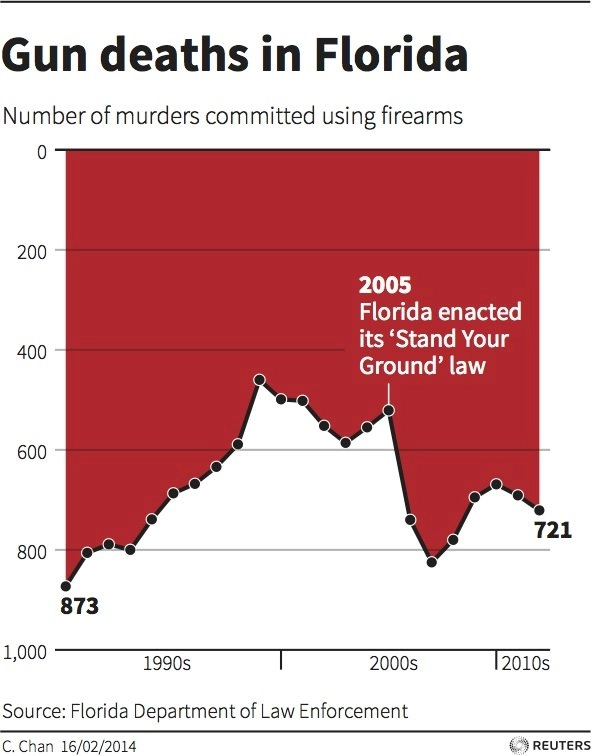{.absolute top=90 left=0 height="500"}

::: fragment
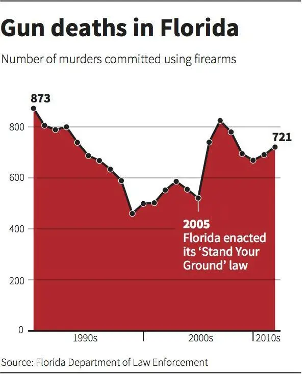{.absolute top=90 left=0 height="456"}
:::

::: footer
Source: Reuters
:::

## Bad charts: CBS News
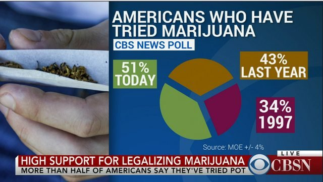

::: footer
Source: CBS News
:::

## WTF Visualizations

<iframe class="stretch" data-src="https://viz.wtf/"></iframe>

::: footer
Source: [WTF Visualizations](https://viz.wtf/)
:::

## Presenting results honestly {.smaller}

- Start bar charts at zero.
- Use percentage points, not percent, for differences between percentages.
- Show the period and the place. One hot summer is not a trend.
- Show how many people answered a survey, and don't present it as representative if it isn't.
- Say where the data comes from, and what's missing.


# Exercise 1 {#exercise-1}

## Check your claims against the data {.smaller}

In your breakout group, **30 minutes**:

1. Identify 3+ main claims of your campaign, like the one from your pre-training task.
2. Look for better evidence using the sources from today or any other sources you may find. Compare what you find across Moldova, Romania and Türkiye.
3. Fill in the **[data quality table](https://docs.google.com/spreadsheets/d/1j5m0VdyFxVBIIJoop8BQa6eNapXgOVN4gWSOyS_JIQQ/edit?usp=sharing)** for each source.
4. Decide: what is still missing, and **who holds it**?
5. 

## The data quality table {.smaller}

Fill in the [spreadsheet here](https://docs.google.com/spreadsheets/d/1j5m0VdyFxVBIIJoop8BQa6eNapXgOVN4gWSOyS_JIQQ/edit?usp=sharing).

```{=html}
<div style="text-align:center;margin-top:0.8em;">
  <div id="timer-display-1" style="font-size:2.5em;font-weight:bold;font-variant-numeric:tabular-nums;">30:00</div>
  <button id="timer-start-1" style="font-size:0.6em;margin:0.2em;padding:0.3em 1em;cursor:pointer;">Start</button>
  <button id="timer-pause-1" style="font-size:0.6em;margin:0.2em;padding:0.3em 1em;cursor:pointer;">Pause</button>
  <button id="timer-reset-1" style="font-size:0.6em;margin:0.2em;padding:0.3em 1em;cursor:pointer;">Reset</button>
</div>
<script>
(function() {
  const total = 30 * 60;
  let remaining = total;
  let timer = null;
  const el = document.getElementById('timer-display-1');
  function fmt(s) { const m = Math.floor(s / 60); const sec = s % 60; return String(m).padStart(2, '0') + ':' + String(sec).padStart(2, '0'); }
  function render() { el.textContent = remaining <= 0 ? "Time's up!" : fmt(remaining); el.style.color = (remaining <= 60 && remaining > 0) ? '#c00' : ''; }
  function tick() { if (remaining > 0) { remaining--; render(); if (remaining === 0) { clearInterval(timer); timer = null; } } }
  document.getElementById('timer-start-1').onclick = () => { if (!timer && remaining > 0) timer = setInterval(tick, 1000); };
  document.getElementById('timer-pause-1').onclick = () => { clearInterval(timer); timer = null; };
  document.getElementById('timer-reset-1').onclick = () => { clearInterval(timer); timer = null; remaining = total; render(); };
  render();
})();
</script>
```

::: notes
Shared sheet, one tab per group. Visit each breakout room.

Hints per group:
- Law and policies: the youth mechanisms table (CoE Advisory Council on Youth, Congress youth delegates, EU President's Youth Advisory Board, EESC youth round tables, local youth councils). IPU: 2.8% of MPs worldwide are 30 or under.
- Youth participation: the survey data; Flash Eurobarometer on Youth and Democracy for comparison.
- Natural garden: Open-Meteo ET0 × plant factor − rainfall.
- Eco-Health Pass: Open-Meteo days above 30°C, overpass turbo, Sensor.Community. The "15–20% drop in focus above 30°C" figure isn't supported by the heat and learning research.
:::


# Break

15 minutes.


# Requesting information {#requesting-information}

## What do you do when the data isn't published? {.smaller}

::: {.incremental}
- **Ask for it.** In all three countries, the right to ask is written into law.
- You don't need to be a journalist, or give a reason.
- Ask for **documents that already exist**: monitoring data, permits, inspection reports, contracts, budgets.
- Don't ask questions or for analysis. Authorities only have to hand over what they hold, and in Türkiye they can refuse requests that need "a separate study".
:::

## Access to information laws {.smaller}

| Country | Law | Deadline |
|:--|:--|:--|
| Moldova | Law 148/2023 (in force since January 2024) | 10 days, plus up to 7 if you are told in writing within the first 10 |
| Romania | Law 544/2001 | 10 days, up to 30 for complex requests if you are told within the first 10 |
| Türkiye | Law 4982 | 15 working days, up to 30 if another unit or institution is involved |

::: notes
Older Moldovan guides still cite Law 982/2000, which Law 148/2023 replaced.
:::

## What to include {.smaller}

- **Moldova:** your name and a **postal address**, even when you send it by email. Without them, the request can lawfully be ignored. No reason or signature needed; electronic replies are free.
- **Romania:** your name and an address for the reply (email is fine), plus a signature if on paper.
- **Türkiye:** your name, address and Turkish ID (T.C.) number, through [CİMER](https://www.cimer.gov.tr/) or the institution's form. Foreigners can only use the law if they live in Türkiye, and only for limited purposes. **A Turkish group member has to send it.**
- **Everywhere:** ask for the reply in an **electronic, editable format**.

## Environmental information is special {.smaller}

- **Romania:** Government Decision 878/2005 gives authorities one month (two for complex requests) and **doesn't allow them to withhold emissions data** as a commercial secret or personal data.
- **Moldova:** Law 148/2023 says the public interest outweighs secrecy when information would help prevent or reveal **harm to the environment**.
- Moldova and Romania are parties to the UNECE **Aarhus Convention** on access to environmental information and public participation. **Türkiye is not.**

::: notes
In 2021, the Aarhus Compliance Committee found Moldova in non-compliance (case ACCC/C/2017/147, brought by Eco-TIRAS), mainly over charges for environmental information.
:::

## If you are refused or ignored {.smaller}

- **Moldova:** go straight to the administrative court, within 30 days of the reply, or within a year if there was no reply. Silence counts as a refusal.
- **Romania:** complain to the head of the institution, or go to court, within 30 days. No court fees.
- **Türkiye:** object to the Board of Review of Access to Information (*Bilgi Edinme Değerlendirme Kurulu*) within 15 days.

## A good request {.smaller}

> Under Law [number], I request the following documents in electronic, editable format (CSV or XLSX):
>
> 1. The monthly water consumption for irrigating public green spaces in [city], 2023–2025.
> 2. The contract for the maintenance of green spaces currently in force.
>
> Please send the reply to [email] / [postal address].

::: {.fragment}
Be **specific**, ask for **existing documents**, and name the **format**.

Keep a shared log: authority, date sent, registration number, deadline. **No personal details.**
:::


# Youth participation {#participation}

## What Europe asks of our cities {.smaller}

- **[CM/Rec(2024)6 on young people and climate action](https://rm.coe.int/cm-rec-2024-6-young-people-and-climate-action/1680b21a0e)** (Council of Europe, October 2024): asks governments to invite local and regional authorities to apply its measures, including access to climate information and data.
- **[European Charter on the Participation of Young People in Local and Regional Life](https://rm.coe.int/cg-2025-49-14finprov-en-european-charter-on-the-participation-of-young/488028e792)**: a new Charter, adopted by the Congress of Local and Regional Authorities in October 2025 and recommended to all member states by the Committee of Ministers in March 2026. It:
  - names **environment and climate change** among the areas where youth perspectives must be considered;
  - asks authorities to use **online consultations, virtual town halls and interactive decision-making platforms**;
  - calls for independent, youth-led and properly funded youth councils.

::: footer
Source: [Council of Europe](https://www.coe.int/web/youth/-/adopted-the-european-charter-on-the-participation-of-young-people-in-local-and-regional-life)
:::

## What exists at home {.smaller}

| Country | Local youth body | Status |
|:--|:--|:--|
| Moldova | Local youth councils, aged 14–35 (Order 2057/2025) | Consultative |
| Romania | Local or county youth councils (Law 350/2006) | Optional, consultative |
| Türkiye | Youth assemblies in city councils (Law 5393, Art. 76) | Optional, consultative |

::: {.fragment}
**No youth body is binding** in any of the three countries. The leverage is transparency law: at least **10 days** to comment on local drafts in Moldova and Romania; public council meetings in Türkiye.
:::

::: notes
Evidence is what turns a consultative voice into a case that has to be answered.

Moldova: 10 working days (Law 239/2008). Romania: drafts announced 30 working days ahead, at least 10 calendar days for written comments (Law 52/2003, Art. 7). Türkiye sets no comment period for local drafts; meetings are public and decision summaries announced within 7 days (Law 5393, Art. 20).
:::


# Exercise 2 {#exercise-2}

## From evidence to campaign sketch {.smaller}

In the same groups, **30 minutes**. Use what you found in Exercise 1.

::: {.incremental}
1. **The problem:** what needs to change?
2. **The authority:** who is responsible and can decide? A city, a ministry, the Council of Europe?
3. **The evidence:** what do you have, and what is missing?
4. **The request:** if any information is missing, draft a request for it.
5. **The ask:** what exactly do you want them to decide, and by when?
6. **The campaign sketch:** how will you use the data you have to enact policy?
:::

::: {.fragment}
Write a 2+ pages Google Docs file outlining all of the above.
:::

::: notes
Leave 5 minutes at the end for a one-minute report from each group.
:::

## Exercise 2: 30 minutes {data-menu-title="Exercise 2 timer"}

```{=html}
<div style="text-align:center;margin-top:0.8em;">
  <div id="timer-display-2" style="font-size:2.5em;font-weight:bold;font-variant-numeric:tabular-nums;">30:00</div>
  <button id="timer-start-2" style="font-size:0.6em;margin:0.2em;padding:0.3em 1em;cursor:pointer;">Start</button>
  <button id="timer-pause-2" style="font-size:0.6em;margin:0.2em;padding:0.3em 1em;cursor:pointer;">Pause</button>
  <button id="timer-reset-2" style="font-size:0.6em;margin:0.2em;padding:0.3em 1em;cursor:pointer;">Reset</button>
</div>
<script>
(function() {
  const total = 30 * 60;
  let remaining = total;
  let timer = null;
  const el = document.getElementById('timer-display-2');
  function fmt(s) { const m = Math.floor(s / 60); const sec = s % 60; return String(m).padStart(2, '0') + ':' + String(sec).padStart(2, '0'); }
  function render() { el.textContent = remaining <= 0 ? "Time's up!" : fmt(remaining); el.style.color = (remaining <= 60 && remaining > 0) ? '#c00' : ''; }
  function tick() { if (remaining > 0) { remaining--; render(); if (remaining === 0) { clearInterval(timer); timer = null; } } }
  document.getElementById('timer-start-2').onclick = () => { if (!timer && remaining > 0) timer = setInterval(tick, 1000); };
  document.getElementById('timer-pause-2').onclick = () => { clearInterval(timer); timer = null; };
  document.getElementById('timer-reset-2').onclick = () => { clearInterval(timer); timer = null; remaining = total; render(); };
  render();
})();
</script>
```


# Conclusions and next steps

## What we covered {.smaller}

- A claim needs **evidence**, a **responsible authority** and a **specific ask**.
- Free data exists at the local, national and European level. Check its quality before you rely on it.
- **Gaps are findings.** When data isn't published, you can request it by law.
- Youth bodies are consultative. Evidence is what makes them hard to ignore.

## After the session

1. Send your information requests, in your own names, and log them.
2. Finish the exercises once the answers come in.
3. Turn them into the **evidence annex of your policy paper**, or a page on the project website comparing data transparency and quality on your topic, with recommendations and campaign ideas.

::: notes
Mention that I'm available for follow-up support after the session. Replies to requests sent this week should arrive by late November (Moldova, Romania) or early December (Türkiye).
:::


# [👋]{.wave} Thank you

```{=html}
<style>
  .wave {
  animation-name: wave-animation;
  animation-duration: 2.5s;
  animation-iteration-count: infinite;
  transform-origin: 70% 70%;
  display: inline-block;
}

@keyframes wave-animation {
    0% { transform: rotate( 0.0deg) }
   10% { transform: rotate(14.0deg) }
   20% { transform: rotate(-8.0deg) }
   30% { transform: rotate(14.0deg) }
   40% { transform: rotate(-4.0deg) }
   50% { transform: rotate(10.0deg) }
   60% { transform: rotate( 0.0deg) }
  100% { transform: rotate( 0.0deg) }
}
</style>
```

- [nicu.md](https://nicu.md/)
- [SAMIZDATA](https://samizdata.co/)
- [mail@nicu.md](mailto:mail@nicu.md)
